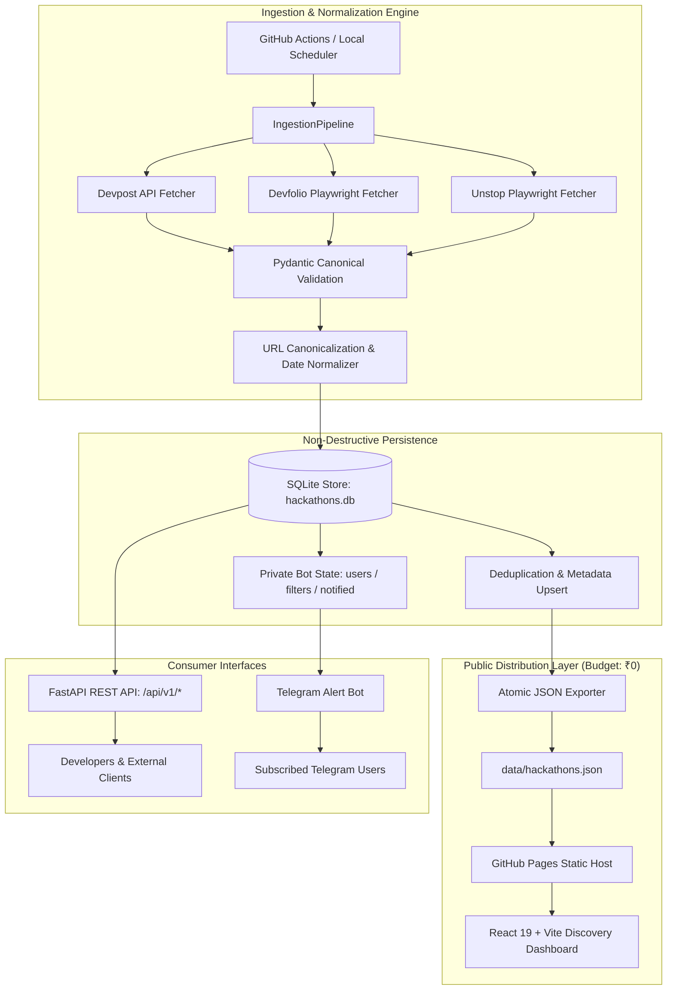

# Hackathon Ingestion Platform (HackPulse)

[](https://github.com/Zenfox-690/hackathon-ingestion-platform/actions/workflows/ci.yml)
[](https://github.com/Zenfox-690/hackathon-ingestion-platform/actions/workflows/ingest_and_publish.yml)
[](https://fastapi.tiangolo.com)
[](https://react.dev)
[](https://www.typescriptlang.org)
[](https://python.org)
[](https://pytest.org)

An enterprise-grade, multi-source hackathon discovery and ingestion platform. Aggregates, validates, and normalizes hackathons across **Devpost**, **Devfolio**, and **Unstop** with canonical URL deduplication, zero-downtime static catalog publishing, an interactive FastAPI backend, and a modern responsive React discovery dashboard.

---

## Architecture & System Design



---

## Key Features

1. **Multi-Source Scraping & API Ingestion**: Resilient extractors for Devpost (API), Devfolio (Playwright headless cards), and Unstop (stripping countdown counters and dynamic badges).
2. **Canonical Deduplication**: SHA-256 fingerprinting based on canonicalized URLs (stripping tracking parameters, fragments, trailing slashes, and casing) with backward-compatibility for legacy database rows.
3. **Non-Destructive Database Migrations**: Explicit migration system upgrading the SQLite schema from 5 basic columns to full rich metadata (description, tags, prizes, location, timestamps) without altering existing rows or dropping tables.
4. **Failure-Safe Public Catalog Publication**: An atomic exporter producing `data/hackathons.json`. Merges new records with the previous catalog baseline, protecting previously valid records if a third-party source encounters a temporary outage.
5. **Strict Public / Private Privacy Boundaries**: Telegram tokens, subscriber chat IDs, custom user filter keywords, and notification histories are permanently quarantined in internal tables and never exported or exposed via API.
6. **FastAPI REST API**: Read-only, high-performance API with full OpenAPI/Swagger documentation, text search, multi-source filtering, status tags, sorting, and bounded pagination.
7. **React 19 + Vite + TypeScript Dashboard**: Modern dark-mode interface featuring glassmorphism, responsive cards, real-time filtering, topic tags, and last-sync indicators. Deployed completely serverless on GitHub Pages at zero infrastructure cost.
8. **Automated CI/CD**: Dual workflows for comprehensive pull-request verification (Ruff, Pytest, Oxlint, TypeScript build) and daily automated ingestion with automatic GitHub Pages deployment.
9. **Dockerized Environment**: Full multi-container `docker-compose.yml` supporting API, frontend, and on-demand ingestion tasks with persistent storage.

---

## Historical Screenshots & Telegram Delivery

<p align="center">
  
  
</p>

---

## Canonical Data Contract

Every hackathon is validated through the Pydantic `Hackathon` model before storage or publication:

```json
{
  "id": "4abc3b427f7d2fae44938cc40562c2881802a0347d6de8402a542a2c79f8181c",
  "fingerprint": "4abc3b427f7d2fae44938cc40562c2881802a0347d6de8402a542a2c79f8181c",
  "name": "Google Cloud Rapid Agent Hackathon",
  "title": "Google Cloud Rapid Agent Hackathon",
  "link": "https://rapid-agent.devpost.com",
  "url": "https://rapid-agent.devpost.com",
  "source": "Devpost",
  "deadline": "2026-06-11T00:00:00",
  "description": "Google Cloud & Vertex AI Developer Challenge",
  "tags": ["ai", "cloud", "python"],
  "prize": "$50,000",
  "location": "Online",
  "status": "open",
  "created_at": "2026-10-16T18:00:00Z",
  "updated_at": "2026-10-16T18:11:43Z"
}
```

---

## REST API Reference

The FastAPI application provides high-speed, read-only endpoints accessible locally or within Docker. Interactive Swagger documentation is available at `/docs`.

### Endpoints

| Method | Endpoint | Description | Query Parameters |
|---|---|---|---|
| `GET` | `/api/v1/health` | Health & database connectivity check | None |
| `GET` | `/api/v1/stats` | Aggregate platform metrics by source & status | None |
| `GET` | `/api/v1/hackathons` | Search and filter hackathons with pagination | `q`, `source`, `tag`, `status`, `sort_by`, `order`, `page`, `limit` |
| `GET` | `/api/v1/hackathons/{id}`| Retrieve single hackathon by SHA-256 fingerprint | `id` (path param) |

### Example Requests

#### 1. Search Open AI Hackathons
```bash
curl "http://localhost:8000/api/v1/hackathons?q=agent&source=Devpost&status=open&limit=5"
```
**Response (200 OK):**
```json
{
  "total": 1,
  "page": 1,
  "limit": 5,
  "total_pages": 1,
  "items": [
    {
      "id": "4abc3b427f7d2fae44938cc40562c2881802a0347d6de8402a542a2c79f8181c",
      "name": "Google Cloud Rapid Agent Hackathon",
      "link": "https://rapid-agent.devpost.com",
      "source": "Devpost",
      "deadline": "2026-06-11T00:00:00",
      "prize": "$50,000",
      "location": "Online",
      "status": "open"
    }
  ]
}
```

#### 2. Service Health Check
```bash
curl "http://localhost:8000/api/v1/health"
```
**Response (200 OK):**
```json
{
  "status": "ok",
  "timestamp": "2026-10-16T18:11:43.793545Z",
  "version": "1.0.0",
  "database_connected": true,
  "total_hackathons": 38,
  "active_hackathons": 26
}
```

---

## Local Development & Setup

### Option A: Native Setup

#### 1. Backend & Ingestion Setup
```bash
# Clone the repository
git clone https://github.com/Zenfox-690/hackathon-ingestion-platform.git
cd hackathon-ingestion-platform

# Create and activate Python virtual environment
python -m venv venv
# Windows:
.\venv\Scripts\activate
# Linux/macOS:
source venv/bin/activate

# Install dependencies and Playwright browsers
pip install -r requirements.txt
playwright install chromium

# Copy environment configuration
cp .env.example .env
```

#### 2. Running Ingestion & Catalog Export
```bash
# Run full scraping pipeline
python main.py

# Run export-only without scraping
python main.py --export-only
```

#### 3. Starting the FastAPI Server
```bash
uvicorn api.app:app --reload --port 8000
# API is accessible at http://localhost:8000
# OpenAPI Docs at http://localhost:8000/docs
```

#### 4. Frontend Dashboard Setup
```bash
cd frontend
npm install
npm run dev
# Dashboard opens at http://localhost:5173
```

---

### Option B: Docker Setup

The platform includes Docker configurations for both development and production.

```bash
# Build and start both API and Frontend
docker compose up --build

# Run one-off ingestion pipeline inside Docker
docker compose run --rm pipeline
```

- **Frontend Dashboard**: `http://localhost:3000`
- **FastAPI Backend**: `http://localhost:8000`
- **FastAPI Documentation**: `http://localhost:8000/docs`

---

## Automated Testing & Code Quality

The test suite covers data models, URL canonicalization, date parsing, database migrations, scraper card parsing, failure preservation, and REST API endpoints.

```bash
# Run full Python test suite with coverage
pytest --cov=. --cov-report=term-missing

# Run Ruff linter
ruff check .

# Run Frontend linting and tests
cd frontend
npm run lint
npm test
npm run build
```

---

## Measured Engineering Metrics

All benchmarks below were measured directly against the current repository state:

| Metric | Measured Value | Verification Method |
|---|---|---|
| **Python Automated Tests** | **38 passed / 0 failed** (100% pass rate) | `pytest` |
| **Python Code Coverage** | **80% overall statement coverage** | `pytest-cov` |
| **Frontend Automated Tests** | **2 passed / 0 failed** (100% pass rate) | Node.js Test Runner |
| **Frontend Build Time** | **334ms** | `vite build` |
| **Frontend Production Bundle** | **73.7 kB** (gzip) | Vite production output |
| **API Latency (Average)** | **7.08 ms** | 50 benchmark requests |
| **API Latency (P50)** | **4.55 ms** | 50 benchmark requests |
| **API Latency (P95)** | **19.86 ms** | 50 benchmark requests |
| **Export Execution Speed** | **6.83 ms** | `exporter.py` timing |
| **Linter Status** | **0 errors, 0 warnings** | `ruff` (backend), `oxlint` (frontend) |
| **Infrastructure Cost** | **₹0.00 / month** | GitHub Actions + GitHub Pages |

---

## Daily Automation & GitHub Pages Deployment

### Workflow Configuration

1. **`ci.yml`**: Runs on every push and pull request to `main`. Verifies Python dependency installation, Ruff linting, Pytest suite with coverage, frontend linting, tests, and production build.
2. **`ingest_and_publish.yml`**: Triggers daily at `06:00 UTC` and manually via `workflow_dispatch`.
   - Executes `python main.py --no-telegram` to refresh the catalog.
   - Preserves baseline data if any third-party source fails.
   - Synchronizes `data/hackathons.json` into the frontend public directory.
   - Builds the production React app.
   - Commits updated catalog data with `[skip ci]` to prevent deployment loops.
   - Deploys static build to GitHub Pages via `actions/deploy-pages@v4`.

### Manual GitHub Pages Setup Steps

To activate the free static dashboard on your GitHub repository:
1. Navigate to **Settings** → **Pages** in your GitHub repository.
2. Under **Build and deployment** → **Source**, select **GitHub Actions**.
3. Under **Settings** → **Actions** → **General** → **Workflow permissions**, enable **Read and write permissions** (needed for automated catalog commits).

---

## Known Assumptions & Limitations

- **Headless Browser Requirements**: Devfolio and Unstop rely on client-side rendering; Playwright with Chromium is required on the host or runner.
- **Bot State Isolation**: SQLite database `hackathons.db` contains user subscriptions and filter keywords for the Telegram bot. These tables are strictly omitted from `data/hackathons.json` and API payloads.
- **Historical Retention Policy**: All hackathons with past deadlines are retained with status `"ended"` to allow historical discovery, while active events are flagged `"open"` or `"upcoming"`.
